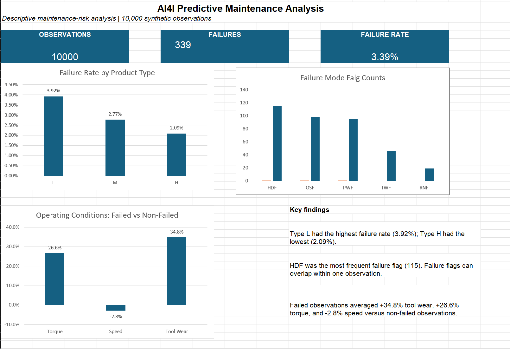

# AI4I Predictive Maintenance Analysis

Descriptive maintenance-risk analysis developed in Microsoft Excel using the AI4I 2020 Predictive Maintenance Dataset.

## Business Question

Which product types, failure modes, and operating conditions are associated with the highest observed machine-failure rate?

## Dataset

The analysis uses the AI4I 2020 Predictive Maintenance Dataset from the UCI Machine Learning Repository.

- 10,000 observations
- 14 original variables
- No missing values
- Synthetic industrial-maintenance data
- Target variable: `Machine failure`

Source: [UCI Machine Learning Repository](https://archive.ics.uci.edu/dataset/601/ai4i+2020+predictive+maintenance)

## Tools and Methods

- Microsoft Excel
- Data-quality validation
- Excel tables and formulas
- PivotTables
- KPI calculation
- Charts and dashboard design
- Descriptive comparison of failed and non-failed observations

## Data Quality Checks

- Confirmed 10,000 source observations
- Confirmed no missing values
- Confirmed no duplicated observation identifiers
- Validated 339 failed observations and a 3.39% overall failure rate
- Checked failure-mode flags separately because multiple flags can occur in one observation

## Key Findings

1. The overall observed failure rate was 3.39%, representing 339 of 10,000 observations.
2. Type L had the highest failure rate at 3.92%, compared with 2.77% for Type M and 2.09% for Type H.
3. Heat-dissipation failure was the most frequent failure flag, with 115 occurrences.
4. Failed observations had 34.8% higher average tool wear and 26.6% higher average torque than non-failed observations.
5. Failed observations had 2.8% lower average rotational speed than non-failed observations.
6. The five failure-mode flags totalled 373 occurrences because some observations contained more than one flag.

## Recommendations

- Review the operating conditions associated with Type L products because this group had the highest observed failure rate.
- Monitor combinations of elevated tool wear and torque as possible maintenance-review indicators.
- Prioritize further investigation of heat-dissipation, overstrain, and power-failure conditions.
- Validate these patterns with real operational and time-based data before making maintenance-policy changes.

## Limitations

- The dataset is synthetic and does not represent a named factory.
- Each row is an observation, not necessarily a unique machine or a timestamped production event.
- The data does not include downtime, repair cost, production shift, plant, or date.
- The analysis cannot calculate OEE, MTBF, MTTR, downtime cost, or time trends.
- The results describe associations and should not be interpreted as causal findings or a predictive model.
- Failure-mode flags can overlap, so their total exceeds the number of failed observations.

## Repository Files

- `AI4I_predictive_maintenance_starter.xlsx` — complete Excel analysis and dashboard
- `dashboard.png` — main dashboard preview
- `README.md` — project documentation

## How to View the Project

1. Download `AI4I_predictive_maintenance_starter.xlsx`.
2. Open the file in Microsoft Excel.
3. Select the `Dashboard` worksheet for the main results.
4. Review the supporting PivotTables and source data in the remaining worksheets.

## Skills Demonstrated

- Data validation and quality control
- KPI definition
- PivotTable analysis
- Data visualization
- Dashboard design
- Interpretation of operational data
- Communication of findings and limitations

## Dataset Citation

AI4I 2020 Predictive Maintenance Dataset. (2020). UCI Machine Learning Repository. [https://doi.org/10.24432/C5HS5C](https://doi.org/10.24432/C5HS5C)

License: Creative Commons Attribution 4.0 International.
